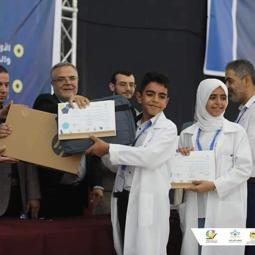
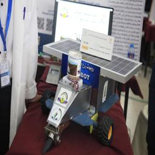
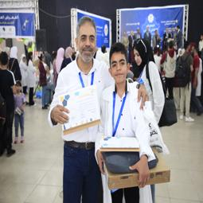
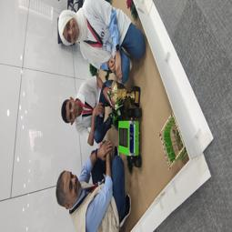
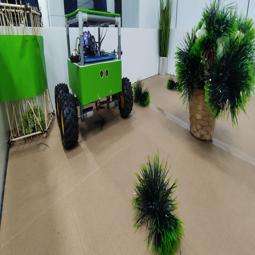
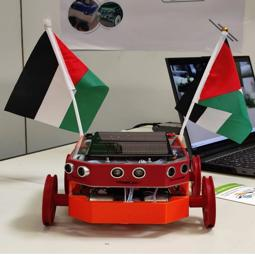
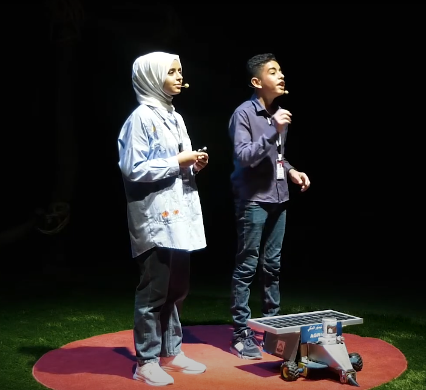
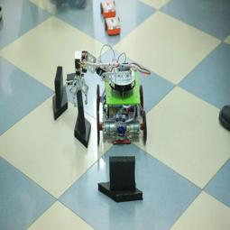
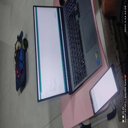

<h1 align="center">🚀 Ibrahim Abu Al Roos</h1>

Full-stack Developer | Robotics Innovator | Tech for Good Advocate

Building tech from Gaza to the world 🌍

  <a href="mailto:ibrahim.sisar@gmail.com">📧 Contact Me</a> • 
  <a href="https://github.com/ibrahim-sisar">🌐 GitHub</a> • 
  <a href="https://www.linkedin.com/in/ibrahim-sisar">🔗 linked in</a> • 
  <a href="https://www.youtube.com/watch?v=hQ-MoyboAKo">🎤 TEDx Talk</a>

---

## 🚀 About Me

I'm a passionate programmer I've built robots, apps, and platforms that aim to change lives — all while self-learning in the middle of crises.

- 🧠 Specialized in Python, JavaScript, and backend frameworks (Django, Flask).
- 🕹️ Robotics expert – Arduino, ESP32, IoT systems.
- 🎮 Game and desktop app maker (Pygame, Tkinter).
- 🎯 Finalist in international robotics competitions.
- 🧰 Contributor to tech for good.

---
## 📅 Availability

I'm currently focused on a demanding academic year and won't be taking on new projects or long-term commitments for the foreseeable future.

I'm always happy to connect, exchange ideas, and learn about interesting projects. For collaborations, engineering opportunities, or team projects, **please feel free to reach out and keep in touch for future opportunities.**

## ⚙️ Technical Skills

### 🖥️ Programming

  

  
  
  
  
  
  
  
  
  
  
  
  
  
  
  
  

### 📚 Frameworks & Libraries

  
  
  
  
  
  
  
  
  
  
  
  

### 🔧 Electronics

  
  
  
  

### 🛠 Tools

  
  
  
  
  
  

## 🏆 Achievements 

<!--  -->
### 🥇 **Scientific and Technical Exhibition**: Achieved **1st Place** and the Grand Prize.

<!-- [img4](image11_resized_255x255.jpg) -->
### 🥇 **WRO Local Competition**: Secured **1st Place** at the national level in Palestine.

<!-- [img4](image5_resized_255x255.jpg)-->
### 🥇 **WRO International Competition**: Ranked **9th Globally** in Germany.

### **[TEDx Speaker](https://www.youtube.com/watch?v=hQ-MoyboAKo)**: Presented my ideas to a global audience.

## 📌 Featured Projects

| Project | Description | Tech |
|--------|-------------|------|
| [QuickChat](https://github.com/ibrahim-sisar/QuickChat) | Social media platform for simplicity & speed | Django, REST |
| [IMDB Clone](https://github.com/ibrahim-sisar/IMDB) | Movie info searcher | Flask, API |
| [Agrebot](https://youtu.be/0nFlWDTcbfs) | Smart farming robot with mobile control | ESP32, App |

---
## Robots

## 🔮 Vision

  <i>This work and journey are dedicated to the memory of my beloved father, 
  <a href="https://github.com/USERNAME_OF_YOUR_FATHER"><b>Said Ibrahim Abu Al-Roos</b></a>. 
  May Allah have mercy on his soul. 🤍</i>

---

## 📬 Let's Connect

📧 **Email**: ibrahim.sisar@gmail.com  
🌐 **GitHub**: [ibrahim-sisar](https://github.com/ibrahim-sisar)  
🔗 **linked in**: [LinkedIn](https://www.linkedin.com/in/ibrahim-sisar) 
🎥 **YouTube**: [TEDx Talk](https://www.youtube.com/watch?v=hQ-MoyboAKo) 

---

> 💡 "Continuous learning is the key to success."  
> **Feel free to reach out for collaboration, sharing ideas, or exploring new opportunities!**
---

